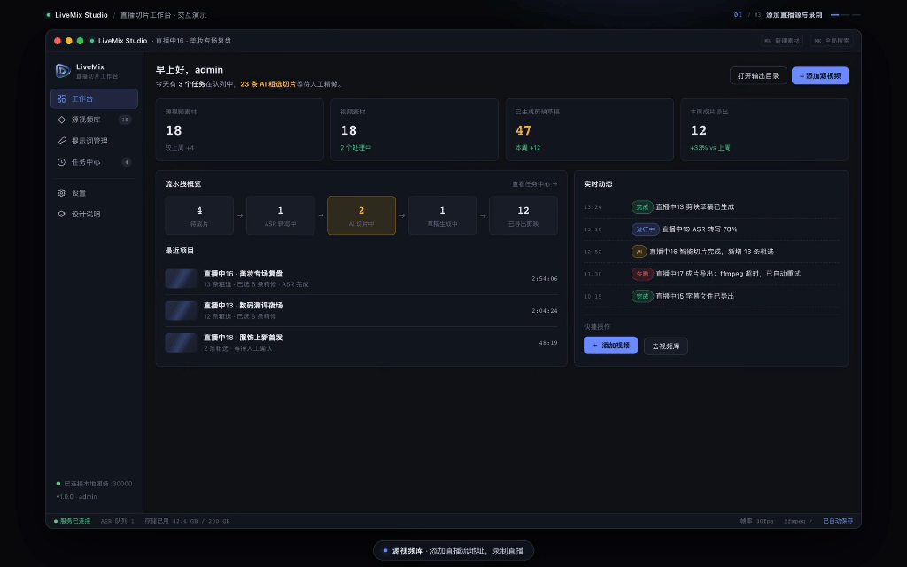

<p align="center">
  <a href="https://gogoshine.com">
    
  </a>
</p>

<h1 align="center">LiveMix Studio</h1>

<p align="center">
  <strong>Live Clip Workbench</strong><br>
  Turn one livestream into dozens of clips ready to publish.<br>
  <sub>Capture · Transcription · Smart selection · CapCut drafts · One-click export</sub>
</p>

<p align="center">
  
  
  
  
</p>

<p align="center">
  <a href="https://gogoshine.com"><strong>Download client</strong></a>
  &nbsp;·&nbsp;
  <a href="#three-steps-to-clips">Quick start</a>
  &nbsp;·&nbsp;
  <a href="#faq">FAQ</a>
  &nbsp;·&nbsp;
  <a href="#self-hosted-deployment">Self-hosting</a>
</p>

<p align="center">
  <sub><a href="README.md">中文</a> · <a href="README.en.md">English</a></sub>
</p>

---

## What it does

A livestream can run for hours. What's worth publishing is often just a dozen 30-second highlights.

LiveMix Studio hands the tedious work to AI: **transcribe the whole session → pick high-value moments from your brief → cut them precisely → generate a CapCut draft**. Run it fully automatically, or let AI make a rough selection and refine it yourself.

Built for **live commerce, knowledge sharing, and gaming & entertainment** teams.

<p align="center">
  
</p>

## Three steps to clips

| Step | You | AI |
|:---:|------|------|
| **1** | **Add material**<br>Paste a replay link or Douyin live room, or drop in a local video | Detects duration and resolution, generates a cover |
| **2** | **Describe what you want**<br>e.g. “pick the parts with a clear pitch and strong emotional beats” | Transcribes the session, selects highlights from your prompt, and cuts them precisely |
| **3** | **Export**<br>Click “Export to CapCut” for finishing, or “Export video” for a ready MP4 | Generates a CapCut draft or renders the final video |

> New here? Start with one short video to learn the flow, then process a full livestream.

## Core features

| Feature | Description |
|------|------|
| **Multiple sources** | Replays, Douyin live rooms (URL or room ID), direct video links, and local files — drag and drop |
| **AI selection** | Speech-to-text plus an LLM that understands the content and picks highlights from your prompt — no more scrubbing the timeline |
| **CapCut drafts** | One click generates a draft you can open in CapCut and keep editing captions, sound effects, BGM, and stickers |
| **One-click export** | Skip CapCut and render an MP4 directly — built for batch output |
| **On-demand download** | Drafts are recorded first; files and media download only when you need them, saving disk space |
| **Local-first** | Media and project data stay on your machine; long jobs run in the background with live progress and retry |

## Download & install

<p align="center">
  <a href="https://gogoshine.com"><strong>Download from gogoshine.com →</strong></a><br>
  <sub>Available for macOS and Windows</sub>
</p>

1. Install and open LiveMix Studio (drag to Applications on macOS; run the installer on Windows).
2. Enter your API key under **Settings → Service Connection**.
3. Add a video and create your first clip.

## FAQ

<details>
<summary><strong>Do I need CapCut?</strong></summary>

No if you only want an MP4. If you want to keep editing, install CapCut and open the generated draft.

</details>

<details>
<summary><strong>Does it need an internet connection?</strong></summary>

Yes. Speech recognition and AI selection run in the cloud; your media and project data stay on your machine.

</details>

<details>
<summary><strong>What video sources are supported?</strong></summary>

Live stream / replay links, Douyin live rooms (URL or room ID), direct video links, and local video files.

</details>

<details>
<summary><strong>Will drafts take up much disk space?</strong></summary>

No. Drafts are recorded first and downloaded only when you click “Export to CapCut” or “Open draft folder”.

</details>

## Self-hosted deployment

> For developers. End users can simply download the client — no server deployment required.

The API and background workers, the CapCut draft service, and nginx all start with Docker Compose.

**Prerequisites**

- Docker / Docker Compose
- PostgreSQL 14+ (create the database first; no bundled DB)
- Object storage: Tencent COS / Alibaba OSS / Volcengine TOS (pick one)
- Doubao speech recognition API key and an OpenAI-compatible LLM API key

**1. Configure environment variables**

```bash
cd backend/docker
cp .env.example .env
# Fill in database, object storage, ASR, and LLM settings
```

**2. Start services**

```bash
docker compose up -d
docker exec -it live-mixer /app/envinit init   # create schema + seed data
```

**3. Verify**

```bash
curl http://localhost:31000/health
# {"status":"ok"}
```

Default admin: `admin` / `admin`. Change it immediately after the first deployment:

```bash
docker exec -it live-mixer /app/envinit reset-password -p 'YourStrongPassword'
```

| Service | Role | Host port |
|---------|------|-----------|
| `live-mixer` | API + background workers | `31000` |
| `capcut-mate` | CapCut draft service | `31001` |
| `nginx` | Reverse proxy + static assets | `81` |

> When deploying to a new environment, update `DRAFT_URL` and `PROXY_*` in `docker-compose.yaml` to match your IP / domain, or draft downloads and proxying may fail.
>
> See [backend/docker/.env.example](backend/docker/.env.example) for all options and [LiveMix/README.md](LiveMix/README.md) for client build and packaging.
>
> To enable final video rendering, set `APP_CAPCUT_MATE_ENABLE_GEN_VIDEO=true` in `.env`.

<p align="center">
  <sub>Server: Go · PostgreSQL · Docker Compose　|　Desktop: Qt 6 · C++17</sub>
</p>

---

## Contact & support

| Type | Contact | Details |
|------|------|------|
| 📱 WeChat group | <div align="center"></div> | Scan to join the LiveMix Studio community |
| 💬 WeChat | <div align="center"></div> | Business inquiries |
| 📧 Email | taohongmin51@gmail.com | Technical support |

---

## License

Released under the [Apache-2.0](./LICENSE) license.

<p align="center">
  <sub>Let AI handle the repetition; keep the final cut in your hands.</sub>
</p>
