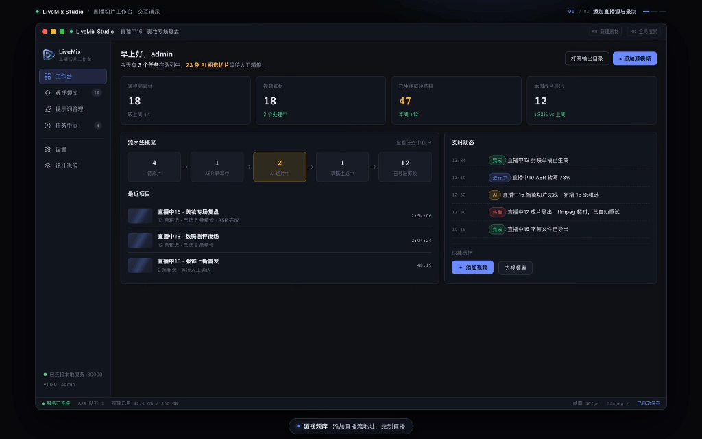

<p align="center">
  <a href="https://gogoshine.com">
    
  </a>
</p>

<h1 align="center">LiveMix Studio</h1>

<p align="center">
  <strong>直播切片工作台</strong><br>
  把一场直播，变成几十条可直接发布的切片。<br>
  <sub>素材采集 · 语音转写 · 智能选段 · 剪映草稿 · 一键成片</sub>
</p>

<p align="center">
  
  
  
  
</p>

<p align="center">
  <a href="https://gogoshine.com"><strong>下载客户端</strong></a>
  &nbsp;·&nbsp;
  <a href="#三步出片">快速上手</a>
  &nbsp;·&nbsp;
  <a href="#常见问题">常见问题</a>
  &nbsp;·&nbsp;
  <a href="#自托管部署">开发者部署</a>
</p>

<p align="center">
  <sub><a href="README.md">中文</a> · <a href="README.en.md">English</a></sub>
</p>

---

## 它能做什么

一场直播动辄几个小时，真正能发布的，可能只是其中十几段几十秒的高光。

LiveMix Studio 把最耗时的部分交给 AI：**自动转写整场内容 → 按你的要求挑出高价值片段 → 精确裁剪 → 生成剪映草稿**。你可以全自动出片，也可以先让 AI 粗选、再由自己精修。

适合 **直播电商、知识分享、游戏娱乐** 等内容团队。

<p align="center">
  
</p>

## 三步出片

| 步骤 | 你来做 | AI 来做 |
|:---:|------|------|
| **1** | **添加素材**<br>粘贴直播回放链接、抖音直播间，或拖入本地视频 | 自动识别时长与分辨率，生成封面 |
| **2** | **提出要求**<br>写下你想要的片段，例如「挑出卖点清晰、有情绪爆点的部分」 | 转写整场内容，按提示词选出高光句段并精确裁剪 |
| **3** | **导出成片**<br>点击「导出到剪映」继续精修，或「导出成片」直接拿到 MP4 | 生成剪映草稿，或直接合成成片 |

> 第一次使用，建议先用一段短素材跑通流程，再处理整场直播。

## 核心功能

| 功能 | 说明 |
|------|------|
| **多种素材来源** | 直播回放、抖音直播间（链接或房间号）、视频下载链接、本地文件，拖进来就能用 |
| **AI 智能选片** | 语音转写 + 大模型理解内容，按提示词挑出高价值片段，不用再拖进度条找高光 |
| **剪映草稿** | 一键生成可直接打开的剪映草稿，字幕、音效、BGM、贴纸都能继续调整 |
| **一键成片** | 不经过剪映，直接输出 MP4，适合批量快速出片 |
| **按需下载** | 草稿生成后先留存记录，需要时才下载草稿与素材，节省磁盘空间 |
| **本地优先** | 素材与项目数据保存在本机；长任务在后台运行，进度实时可见，失败可重试 |

## 下载安装

<p align="center">
  <a href="https://gogoshine.com"><strong>前往官网下载 →</strong></a><br>
  <sub>支持 macOS 与 Windows</sub>
</p>

1. 安装并打开 LiveMix Studio（macOS 拖入「应用程序」，Windows 双击安装包）。
2. 在「设置 → 服务连接」中填写 API 密钥。
3. 添加一段素材，开始制作第一条切片。

## 常见问题

<details>
<summary><strong>需要安装剪映吗？</strong></summary>

只导出成片 MP4 不需要。如果需要继续精修，请安装剪映并用它打开生成的草稿。

</details>

<details>
<summary><strong>使用需要联网吗？</strong></summary>

需要。语音识别与 AI 选片由云端服务完成，素材与项目数据保存在本机。

</details>

<details>
<summary><strong>支持哪些视频来源？</strong></summary>

直播流 / 回放链接、抖音直播间（链接或房间号）、视频下载链接，以及本地视频文件。

</details>

<details>
<summary><strong>草稿会占用很多磁盘空间吗？</strong></summary>

不会。草稿生成后先留存记录，点击「导出到剪映」或「打开草稿文件夹」时才下载草稿与素材。

</details>

## 自托管部署

> 面向开发者。普通用户直接下载客户端即可，无需部署服务端。

服务端（API + 后台 Worker）、剪映草稿服务与 nginx 通过 Docker Compose 一键启动。

**前置条件**

- Docker / Docker Compose
- PostgreSQL 14+（需提前创建数据库）
- 对象存储：腾讯云 COS / 阿里云 OSS / 火山引擎 TOS（任选其一）
- 豆包语音识别 API Key、OpenAI 兼容大模型 API Key

**1. 配置环境变量**

```bash
cd backend/docker
cp .env.example .env
# 填写数据库、对象存储、ASR、LLM 等配置
```

**2. 启动服务**

```bash
docker compose up -d
docker exec -it live-mixer /app/envinit init   # 建表 + 写入种子数据
```

**3. 验证**

```bash
curl http://localhost:31000/health
# {"status":"ok"}
```

默认管理员账号 `admin` / `admin`，首次部署请立即修改密码：

```bash
docker exec -it live-mixer /app/envinit reset-password -p 'YourStrongPassword'
```

| 服务 | 作用 | 宿主机端口 |
|------|------|------------|
| `live-mixer` | API + 后台 Worker | `31000` |
| `capcut-mate` | 剪映草稿服务 | `31001` |
| `nginx` | 反向代理与静态资源 | `81` |

> 部署到新环境时，请按实际 IP / 域名调整 `docker-compose.yaml` 中的 `DRAFT_URL` 与 `PROXY_*`，否则草稿下载或代理可能失败。
>
> 完整配置项见 [backend/docker/.env.example](backend/docker/.env.example)；客户端构建与打包见 [LiveMix/README.md](LiveMix/README.md)。
>
> 如需「导出成片」，在 `.env` 中设置 `APP_CAPCUT_MATE_ENABLE_GEN_VIDEO=true`。

<p align="center">
  <sub>服务端 Go · PostgreSQL · Docker Compose　|　桌面端 Qt 6 · C++17</sub>
</p>

---

## 联系与支持

<p align="center">
  <a href="https://gogoshine.com">官网</a>
  &nbsp;·&nbsp;
  <a href="https://github.com/Chyona/live-mixer">GitHub</a>
  &nbsp;·&nbsp;
  <a href="mailto:taohongmin51@gmail.com">邮箱</a>
</p>

| 加入交流群 | 商务合作 |
|:---:|:---:|
|  |  |
| 扫码加入交流群 | 扫码添加微信 |

<p align="center">技术支持：<a href="mailto:taohongmin51@gmail.com">taohongmin51@gmail.com</a></p>

---

## 许可证

本项目采用 [Apache-2.0](./LICENSE) 许可证开源。

<p align="center">
  <sub>把重复劳动交给 AI，把成片质量留在手里。</sub>
</p>
