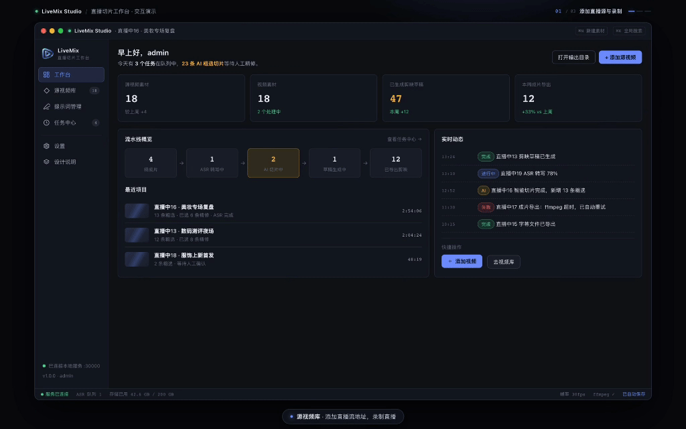

<p align="center">
  <a href="https://gogoshine.com"></a>
</p>

<h1 align="center">直播切片工作台</h1>

<p align="center">
  <strong>AI 辅助直播切片</strong> · 语音识别 · 智能选段 · 剪映草稿 · 一键成片
</p>

<p align="center">
  <a href="README.md">中文</a> · <a href="README.en.md">English</a>
</p>

> 仓库技术名：`live-mixer`。产品由两部分组成：**LiveMix Studio 桌面客户端**负责素材采集与本地创作，**live-mixer 服务端**负责 ASR、AI 选片、剪映草稿与成片任务。

---

## 下载客户端

> **下载地址：[https://gogoshine.com](https://gogoshine.com)**
>
> 支持 **macOS / Windows**；无需安装，也可直接在浏览器中[在线体验](https://gogoshine.com)完整工作台。

---

## 桌面客户端 LiveMix Studio

LiveMix Studio 基于 **Qt 6 / C++17** 构建，与 live-mixer 服务端配合使用。它把「素材采集 → ASR 转写 → AI 选片 → 剪映草稿」整条流水线搬到桌面端，适合需要本地录制与批量出片的剪辑团队。



### 核心功能

| 能力 | 说明 |
|------|------|
| 源视频采集 | 直播流录制（`http/https/rtmp/rtsp`）、mp4 直链下载、本地视频导入（支持拖拽），自动识别时长与分辨率 |
| 视频预览 | 卡片封面自动截帧，应用内播放器支持播放/暂停与进度拖动；HLS 录像边转封装边播放 |
| 一键成片 | ASR 整片转写 → LLM 按提示词选片 → ffmpeg 精确裁剪 → 生成剪映草稿，过程页实时展示阶段与进度 |
| 草稿按需下载 | 草稿生成后先落库，点击「打开草稿文件夹」时才下载草稿与素材，节省本地空间 |
| 任务中心 | 任务持久化到本地 SQLite，运行中实时进度、失败重试、完成后查看成片 |
| 本地优先 | 配置与业务数据保存在本机（JSON + SQLite），支持 macOS 与 Windows 打包 |

> 构建、打包（macOS DMG / Windows 安装包）与实现细节详见 [LiveMix/README.md](LiveMix/README.md)。

---

## 服务端部署与使用（live-mixer）

`live-mixer` 是面向 **直播回放 / 录像** 的自建后端：素材入库、ASR 转写、AI 智能选段、剪映草稿与成片导出一条链路打通。桌面客户端与网页端共用同一套 API，既支持「全自动一键成片」，也支持「AI 粗选 + 人工精修」——把重复劳动交给模型，把成片质量留在人手里。

**适合谁用**

- 直播电商、知识付费、游戏与娱乐等需要高频出切片的团队
- 希望用大模型加速「听稿选段」，再用剪映完成后期包装的创作者与剪辑师
- 需要可自建、可私有化部署的直播切片 / 混剪后端服务的研发团队

### 核心能力

| 能力 | 说明 |
|------|------|
| 直播素材管理 | 录入回放 / 录像 URL（文件或 m3u8），自动探测分辨率与时长 |
| 语音识别（ASR） | 异步转写，输出分句、摘要与段落结构，可下载字幕 |
| 剪辑项目 | 关联素材与系统提示词，维护粗选区间 `clips0` 与精修选段 `clips1` |
| AI 直播切片 | 按提示词与粗选区间，从 ASR 中筛选高价值句段并回写 `clips1` |
| 剪映草稿生成 | 精确裁剪素材，调用 capcut-mate 生成可继续后期的剪映草稿 |
| 一键成片 | 串联「AI 切片 → 草稿 →（可选）视频生成」，适合批量快速出片 |
| AI + 人工协同 | AI 出选段后人工调整 `clips1`，再单独跑草稿任务 |

### 典型工作流

```text
录入直播素材
  → ASR 转写 / 摘要
  → 创建剪辑项目（素材 + 提示词，可选粗选 clips0）
  → 路径 A：一键成片（AI 切片 + 草稿 + 可选成片）
  → 路径 B：AI 切片 → 人工精修 clips1 → 生成草稿
  → 下载剪映草稿继续后期
```

### 技术栈

| 层级 | 技术 |
|------|------|
| API / Worker | Go、Gin、异步任务调度 |
| 数据存储 | PostgreSQL 14+ |
| 语音识别 | 豆包 BigModel ASR |
| 大模型 | OpenAI 兼容协议（如阿里云 DashScope） |
| 剪映草稿 | capcut-mate |
| 对象存储 | 腾讯云 COS / 阿里云 OSS / 火山引擎 TOS（任选其一） |
| 部署 | Docker Compose（API + capcut-mate + nginx） |

### 快速开始（Docker）

#### 前置条件

- Docker / Docker Compose
- 可访问的 **PostgreSQL 14+**（需提前建库，服务不内置数据库）
- 已配置的对象存储、ASR Key、大模型 Key

#### 1. 准备环境变量

```bash
cd docker
cp .env.example .env
```

请至少填写：`APP_DATABASE_*`、`APP_JWT_SECRET`、`APP_STORAGE_*`、`APP_ASR_API_KEY`、`APP_LLM_API_KEY`、`APP_CAPCUT_MATE_BASE_URL`。

Compose 内剪映地址一般填 `http://nginx`。可选：

- `APP_CAPCUT_MATE_GEN_VIDEO_BASE_URL`：视频生成接口独立根地址（未设则走 `BASE_URL`）
- `APP_CAPCUT_MATE_ENABLE_GEN_VIDEO`：是否导出成片（默认开启；关闭则草稿完成后直接结束任务）

配置优先级：**环境变量 `APP_*` > 外部 yaml > 内嵌默认配置**。

#### 2. 初始化数据库

```bash
go run ./cmd/envinit init
# 或
docker exec -it live-mixer /app/envinit init
```

默认账号：`admin` / `admin`（生产环境请立刻改密）。

```bash
go run ./cmd/envinit reset-password -p 'YourStrongPassword'
```

#### 3. 启动与验证

```bash
cd docker
docker compose up -d
# 如需本地构建：docker compose up -d --build

curl http://localhost:30000/health
curl http://localhost:81/openapi/live-mixer/v1/auth/login
```

| 服务 | 作用 | 宿主机端口 |
|------|------|------------|
| `live-mixer` | API + 后台 Worker | `30000` |
| `capcut-mate` | 剪映草稿服务 | `31001` |
| `nginx` | 静态资源与反向代理 | `81` |

日志目录：`docker/logs/` · 暂存目录：`docker/html/` · ASR 临时目录：`docker/temp/`（超过 24 小时自动清理）

> 部署到新环境时，请按实际网关与域名调整 `docker-compose.yaml` 中的 `PROXY_*` / `DRAFT_URL`，否则草稿下载或代理可能失败。

### 主要 API

除登录外均需 JWT。完整文档见 Swagger：`http://localhost:30000/swagger/index.html`。

| 方法 | 路径 | 说明 |
|------|------|------|
| POST | `/openapi/live-mixer/v1/auth/login` | 登录获取 Token |
| CRUD | `/openapi/live-mixer/v1/live-materials` | 直播素材 |
| GET | `/openapi/live-mixer/v1/live-materials/:id/video-projects` | 素材关联的剪辑项目 |
| CRUD | `/openapi/live-mixer/v1/video-projects` | 剪辑项目 |
| CRUD | `/openapi/live-mixer/v1/llm-system-prompts` | 系统提示词 |
| POST | `/openapi/live-mixer/v1/tasks/ai-slice` | AI 切片任务 |
| POST | `/openapi/live-mixer/v1/tasks/draft` | 剪映草稿任务 |
| POST | `/openapi/live-mixer/v1/tasks/ai-slice-draft` | 一键成片任务 |
| GET | `/openapi/live-mixer/v1/tasks/:id` | 轮询任务进度 / 草稿与成片地址 |

### 本地开发

#### 环境要求

- Go **1.25+**
- PostgreSQL **14+**
- ffmpeg（ASR 抽音频与切片裁剪；Docker 镜像已内置）

#### 项目结构

```text
live-mixer/
├── cmd/webserver/     # HTTP API + Worker 入口
├── cmd/envinit/       # 建表 / 种子数据 / 重置密码
├── internal/          # handler · service · repository · draft · scheduler …
│   ├── config/        # 本地用 config.yaml（gitignore）；仓库提供 example
│   └── pkg/           # jwt · response · utils 及 ASR/LLM/存储等内部包
├── docker/            # Dockerfile、compose、.env.example
├── docs/              # Swagger 生成物
└── migrations/        # SQL 参考脚本
```

#### 常用命令

```bash
go mod download
cp internal/config/config.yaml.example internal/config/config.yaml

go run ./cmd/envinit init
go run ./cmd/webserver

go build -o webserver.exe ./cmd/webserver
go build -o envinit.exe ./cmd/envinit

go test ./...
```

默认监听 `http://localhost:30000`。可用环境变量覆盖密钥，例如：

```bash
# Windows PowerShell
$env:APP_DATABASE_PASSWORD="your_password"
$env:APP_LLM_API_KEY="sk-xxx"
$env:APP_CAPCUT_MATE_API_KEY="your-capcut-api-key"
```

`envinit` 子命令：`schema` · `seed` · `init` · `reinit`（清空重建）· `reset-password`。

本地无 capcut-mate 时，可只启动 `docker compose up -d capcut-mate nginx`，并将 `capcut_mate.base_url` 指向 `http://localhost:81`。

#### 二次开发建议

- 分层：`handler` → `service` → `repository` → `model`；异步任务在 `scheduler`，剪映流水线在 `draft`
- 新增 API：补 Swagger 注释，在 `internal/routes/v1` 注册；需鉴权的放入 `JWTAuth` 分组
- 新配置项同步更新 `config.yaml.example`、结构体与 `docker/.env.example`
- AI 切片 / 草稿 / 一键成片均为异步任务，客户端轮询 `GET /tasks/:id`

#### 发布镜像

推送形如 `v1.0.0` 的 tag 后，GitHub Actions 会构建并推送 Docker Hub 镜像。

---

## 文档与语言

| 文档 | 说明 |
|------|------|
| [README.md](README.md) | 中文说明（默认） |
| [README.en.md](README.en.md) | English documentation |
| [LiveMix/README.md](LiveMix/README.md) | 桌面客户端构建、打包与实现说明 |
| [LICENSE](LICENSE) | 开源许可 |

关键词：直播切片、AI 切片、直播混剪、语音识别 ASR、剪映草稿、一键成片、直播切片工作台、live-mixer

---

## 许可证

详见仓库根目录 [LICENSE](./LICENSE)。
